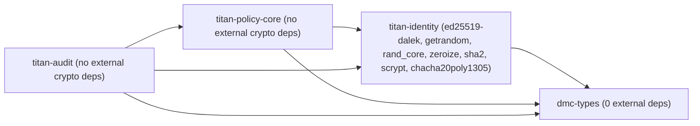
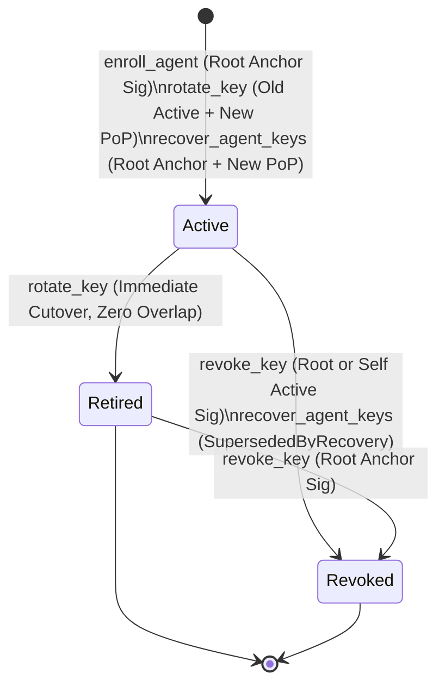

# DMC M2 — Interface Reference (`DMC-M2-INTERFACE-REFERENCE`)

- **Parent Specification:** [DMC-M2-SPEC-001_v1.0.md](file:///data/data/com.termux/files/home/digital-mineral-civilization/docs/m2/DMC-M2-SPEC-001_v1.0.md)
- **Authorization IDs:** `DMC-M2-AUTH-001`, `DMC-M2-DEC-002`
- **Implementation Status:** **NOT AUTHORIZED** (Interface Reference Only)

---

## 1. Crate Dependency Boundaries and DAG

The workspace crate dependency graph remains a strict Directed Acyclic Graph (DAG):



- **[core/dmc-types](file:///data/data/com.termux/files/home/digital-mineral-civilization/core/dmc-types/Cargo.toml):** Zero external dependencies. Hosts all identifier newtypes, raw public-key/signature byte wrappers, `DMC-CANON-V1` wire framing traits and implementations, lifecycle record structs, and structured security-event descriptors.
- **[core/titan-identity](file:///data/data/com.termux/files/home/digital-mineral-civilization/core/titan-identity/Cargo.toml):** Depends on `dmc-types` plus the approved RustCrypto crates (`ed25519-dalek`, `getrandom`, `rand_core`, `zeroize`, `sha2`, `scrypt`, and `chacha20poly1305`). Hosts `RootTrustAnchorSet`, `DevSigningKey`, `DevKeystore`, `ReplayTracker`, `CryptographicIdentityRegistry`, and `CryptographicLiveProvenanceSeal`.
- **[core/titan-policy-core](file:///data/data/com.termux/files/home/digital-mineral-civilization/core/titan-policy-core/Cargo.toml):** Depends on `dmc-types` and `titan-identity`. Hosts `PolicyTrustLevel::CryptographicLiveProvenanceVerified` and `policy_evaluate_strict_cryptographic_provenance`.
- **[core/titan-audit](file:///data/data/com.termux/files/home/digital-mineral-civilization/core/titan-audit/Cargo.toml):** Depends on `dmc-types`, `titan-identity`, and `titan-policy-core`. Consumes `SecurityAuditRecord` and sequences M2 lifecycle and security-failure events in `InMemoryAuditSequencer`.

---

## 2. `core/dmc-types` Interfaces

### 2.1 New Validated Identifier Newtypes
Constructed via the existing `define_typed_id!` macro in [core/dmc-types/src/lib.rs](file:///data/data/com.termux/files/home/digital-mineral-civilization/core/dmc-types/src/lib.rs#L147-L220), enforcing non-empty, trimmed, whitespace-free, control-character-free invariants and maximum length `<= 128` bytes in `DMC-CANON-V1`:

```rust
define_typed_id!(
    /// Distinct identifier for an agent cryptographic key credential.
    KeyId,
    "key"
);

define_typed_id!(
    /// Distinct identifier for an authentication challenge.
    ChallengeId,
    "challenge"
);

define_typed_id!(
    /// Distinct identifier for a pinned Founder Root Trust Anchor key.
    RootAnchorId,
    "root_anchor"
);

define_typed_id!(
    /// Distinct identifier for a key rotation record.
    KeyRotationId,
    "key_rotation"
);

define_typed_id!(
    /// Distinct identifier for a key revocation record.
    KeyRevocationId,
    "key_revocation"
);

define_typed_id!(
    /// Distinct identifier for a credential recovery record.
    RecoveryId,
    "recovery"
);
```

### 2.2 Extended `IdentityTrustStatus`
Extends [core/dmc-types/src/lib.rs](file:///data/data/com.termux/files/home/digital-mineral-civilization/core/dmc-types/src/lib.rs#L92-L114):

```rust
#[derive(Debug, Clone, Copy, PartialEq, Eq, Hash)]
pub enum IdentityTrustStatus {
    UnverifiedClaim,
    LocalProvisional,
    /// Verified via Ed25519 challenge-response against a live CryptographicIdentityRegistry (M2).
    CryptographicallyVerified,
    Revoked,
    Rejected,
}

impl IdentityTrustStatus {
    pub fn stable_name(&self) -> &'static str {
        match self {
            Self::UnverifiedClaim => "unverified_claim",
            Self::LocalProvisional => "local_provisional",
            Self::CryptographicallyVerified => "cryptographically_verified",
            Self::Revoked => "revoked",
            Self::Rejected => "rejected",
        }
    }
}
```

### 2.3 Cryptographic Primitives & Lifecycle Value Types (`dmc-types`)

```rust
/// Approved signature algorithm identifiers for DMC-CANON-V1.
#[derive(Debug, Clone, Copy, PartialEq, Eq, Hash)]
#[repr(u8)]
pub enum SignatureAlgorithmId {
    Ed25519 = 0x01,
}

impl SignatureAlgorithmId {
    pub fn from_u8(tag: u8) -> Result<Self, CanonWireError>;
    pub fn stable_name(&self) -> &'static str; // "ed25519"
}

/// Approved password-based KDF identifiers for DMC-DEV-KEYSTORE-V1 (DMC-M2-DEC-002).
#[derive(Debug, Clone, Copy, PartialEq, Eq, Hash)]
#[repr(u8)]
pub enum KdfAlgorithmId {
    Scrypt = 0x01,
}

/// Approved AEAD cipher identifiers for DMC-DEV-KEYSTORE-V1 (DMC-M2-DEC-002).
#[derive(Debug, Clone, Copy, PartialEq, Eq, Hash)]
#[repr(u8)]
pub enum AeadAlgorithmId {
    ChaCha20Poly1305 = 0x01,
}

/// 32-byte raw Ed25519 public key material (dependency-free value representation).
#[derive(Clone, Copy, PartialEq, Eq, PartialOrd, Ord, Hash)]
pub struct Ed25519PublicKeyBytes(pub [u8; 32]);

/// 64-byte raw Ed25519 signature bytes (dependency-free value representation).
#[derive(Clone, Copy, PartialEq, Eq, Hash)]
pub struct Ed25519SignatureBytes(pub [u8; 64]);

/// Custody assurance level recorded on keys and keystore envelopes (Decision 3).
#[derive(Debug, Clone, Copy, PartialEq, Eq, Hash)]
#[repr(u8)]
pub enum CustodyAssuranceLevel {
    /// Termux local development keystore (rejected at production security boundaries).
    LocalDevelopmentOnly = 0x01,
}

impl CustodyAssuranceLevel {
    pub fn stable_name(&self) -> &'static str; // "local_development_only"
    pub fn is_permitted_for_production(&self) -> bool { false }
}

/// Reason classification for key or agent revocation.
#[derive(Debug, Clone, Copy, PartialEq, Eq, Hash)]
#[repr(u8)]
pub enum RevocationReasonCode {
    KeyCompromise = 0x01,
    KeyLost = 0x02,
    AdministrativeTermination = 0x03,
    SupersededByRecovery = 0x04,
}

/// Lifecycle state of a registered PublicKeyRecord (Decisions 6, 7, 8).
#[derive(Debug, Clone, PartialEq, Eq)]
pub enum KeyLifecycleStatus {
    Active,
    Retired {
        superseded_by: KeyId,
        retired_at_sequence: u64,
        retired_at_epoch_secs: u64,
    },
    Revoked {
        revocation_id: KeyRevocationId,
        reason_code: RevocationReasonCode,
        reason: String,
        revoked_at_sequence: u64,
        revoked_at_epoch_secs: u64,
    },
}

/// Authoritative public-key record stored in CryptographicIdentityRegistry.
#[derive(Debug, Clone, PartialEq, Eq)]
pub struct PublicKeyRecord {
    pub key_id: KeyId,
    pub agent_id: AgentId,
    pub algorithm: SignatureAlgorithmId,
    pub public_key: Ed25519PublicKeyBytes,
    pub custody_assurance: CustodyAssuranceLevel,
    pub status: KeyLifecycleStatus,
    pub registered_at_sequence: u64,
    pub activated_at_epoch_secs: u64,
    pub expires_at_epoch_secs: u64,
}
```

### 2.4 Canonical Wire Framing & Signed Record Types (`dmc-types`)

```rust
pub const DMC_CANON_MAGIC: &[u8; 11] = b"DMC-SIG-V1\0";
pub const DMC_CANON_PROTOCOL_VERSION: u16 = 1;
pub const DMC_CANON_SCHEMA_VERSION: u16 = 1;
pub const MAX_CANON_MESSAGE_BYTES: usize = 4096;
pub const MAX_CANON_IDENTIFIER_BYTES: usize = 128;
pub const MAX_CANON_REASON_BYTES: usize = 512;

#[derive(Debug, Clone, Copy, PartialEq, Eq, Hash)]
#[repr(u8)]
pub enum CanonMessageType {
    Enrollment = 0x01,
    AuthChallenge = 0x02,
    AuthClaim = 0x03,
    KeyRotation = 0x04,
    KeyRevocation = 0x05,
    CredentialRecovery = 0x06,
}

#[derive(Debug, Clone, PartialEq, Eq)]
pub enum CanonWireError {
    MessageTooShort { actual: usize, min: usize },
    MessageTooLarge { actual: usize, max: usize },
    InvalidMagicPrefix,
    UnsupportedProtocolVersion(u16),
    UnsupportedSchemaVersion(u16),
    UnknownMessageType(u8),
    UnexpectedMessageType { expected: CanonMessageType, actual: CanonMessageType },
    UnknownAlgorithmId(u8),
    UnexpectedEndOfBuffer { offset: usize, needed: usize },
    FieldLengthExceedsMaximum { field: &'static str, length: usize, max: usize },
    EmptyRequiredField(&'static str),
    InvalidUtf8(&'static str),
    InvalidIdentifier { field: &'static str, error: IdValidationError },
    InvalidEnumTag { field: &'static str, tag: u8 },
    TrailingBytes { remaining: usize },
}

pub trait CanonicalPayload: Sized {
    const MESSAGE_TYPE: CanonMessageType;
    /// Encodes the complete DMC-CANON-V1 signable byte frame (17-byte header + payload fields).
    fn encode_canonical_signable(&self) -> Result<Vec<u8>, CanonWireError>;
    /// Strictly decodes a DMC-CANON-V1 signable byte slice, rejecting trailing or malformed bytes.
    fn decode_canonical_signable(bytes: &[u8]) -> Result<Self, CanonWireError>;
}

/// 1. Enrollment Record (Message Type 0x01)
#[derive(Debug, Clone, PartialEq, Eq)]
pub struct IdentityRegistrationPayload {
    pub agent_id: AgentId,
    pub department: String,
    pub max_autonomy: AutonomyLevel,
    pub key_id: KeyId,
    pub public_key: Ed25519PublicKeyBytes,
    pub custody_assurance: CustodyAssuranceLevel,
    pub expected_registry_sequence: u64,
    pub issued_at_epoch_secs: u64,
    pub expires_at_epoch_secs: u64,
}

#[derive(Debug, Clone, PartialEq, Eq)]
pub struct IdentityRegistration {
    pub payload: IdentityRegistrationPayload,
    pub root_anchor_id: RootAnchorId,
    pub root_signature: Ed25519SignatureBytes,
}

/// 2. Authentication Challenge Payload (Message Type 0x02)
#[derive(Debug, Clone, PartialEq, Eq)]
pub struct AuthChallengePayload {
    pub challenge_id: ChallengeId,
    pub nonce: [u8; 32],
    pub target_agent_id: AgentId,
    pub verifier_instance_id: u64,
    pub registry_sequence_at_issue: u64,
    pub issued_at_epoch_ms: u64,
    pub expires_at_epoch_ms: u64,
}

/// 3. Signed Identity Claim (Message Type 0x03)
#[derive(Debug, Clone, PartialEq, Eq)]
pub struct SignedIdentityClaimPayload {
    pub challenge_id: ChallengeId,
    pub nonce: [u8; 32],
    pub agent_id: AgentId,
    pub key_id: KeyId,
    pub claimed_department: String,
    pub claimed_autonomy: AutonomyLevel,
    pub verifier_instance_id: u64,
    pub registry_sequence_bound: u64,
    pub signed_at_epoch_ms: u64,
    pub expires_at_epoch_ms: u64,
}

#[derive(Debug, Clone, PartialEq, Eq)]
pub struct SignedIdentityClaim {
    pub payload: SignedIdentityClaimPayload,
    pub signature: Ed25519SignatureBytes,
}

/// 4. Key Rotation Record (Message Type 0x04)
#[derive(Debug, Clone, PartialEq, Eq)]
pub struct KeyRotationPayload {
    pub rotation_id: KeyRotationId,
    pub agent_id: AgentId,
    pub old_key_id: KeyId,
    pub new_key_id: KeyId,
    pub new_public_key: Ed25519PublicKeyBytes,
    pub custody_assurance: CustodyAssuranceLevel,
    pub expected_registry_sequence: u64,
    pub rotated_at_epoch_secs: u64,
    pub new_key_expires_at_epoch_secs: u64,
}

#[derive(Debug, Clone, PartialEq, Eq)]
pub struct KeyRotationRecord {
    pub payload: KeyRotationPayload,
    pub old_key_signature: Ed25519SignatureBytes,
    pub new_key_pop_signature: Ed25519SignatureBytes,
}

/// 5. Key Revocation Record (Message Type 0x05)
#[derive(Debug, Clone, PartialEq, Eq)]
pub enum RevocationAuthority {
    SelfActiveKey(KeyId),
    FounderRootAnchor(RootAnchorId),
}

#[derive(Debug, Clone, PartialEq, Eq)]
pub struct KeyRevocationPayload {
    pub revocation_id: KeyRevocationId,
    pub agent_id: AgentId,
    pub target_key_id: KeyId,
    pub revoke_entire_agent: bool,
    pub reason_code: RevocationReasonCode,
    pub reason: String,
    pub authorizing_authority: RevocationAuthority,
    pub expected_registry_sequence: u64,
    pub revoked_at_epoch_secs: u64,
}

#[derive(Debug, Clone, PartialEq, Eq)]
pub struct KeyRevocationRecord {
    pub payload: KeyRevocationPayload,
    pub authorizing_signature: Ed25519SignatureBytes,
}

/// 6. Credential Recovery Record (Message Type 0x06)
#[derive(Debug, Clone, PartialEq, Eq)]
pub struct RootSignatureApproval {
    pub root_anchor_id: RootAnchorId,
    pub signature: Ed25519SignatureBytes,
}

#[derive(Debug, Clone, PartialEq, Eq)]
pub struct RecoveryPayload {
    pub recovery_id: RecoveryId,
    pub agent_id: AgentId,
    pub new_key_id: KeyId,
    pub new_public_key: Ed25519PublicKeyBytes,
    pub custody_assurance: CustodyAssuranceLevel,
    pub reason: String,
    pub required_threshold: u8,
    pub expected_registry_sequence: u64,
    pub recovered_at_epoch_secs: u64,
    pub new_key_expires_at_epoch_secs: u64,
}

#[derive(Debug, Clone, PartialEq, Eq)]
pub struct RecoveryRecord {
    pub payload: RecoveryPayload,
    pub root_approvals: Vec<RootSignatureApproval>,
    pub new_key_pop_signature: Ed25519SignatureBytes,
}
```

### 2.5 Security Observability Descriptors (`dmc-types`)
Defined in `dmc-types` so `titan-identity` can return structured security telemetry without introducing a cyclic dependency on `titan-audit`:

```rust
#[derive(Debug, Clone, Copy, PartialEq, Eq, Hash)]
pub enum SecurityFailureCode {
    InvalidSignature,
    ReplayAttempt,
    RevokedCredential,
    UnauthorizedRecovery,
    RegistryRollbackDetected,
    InvalidRotation,
    RootTrustFailure,
    KeystorePermissionViolation,
}

impl SecurityFailureCode {
    pub fn stable_name(&self) -> &'static str;
}

#[derive(Debug, Clone, PartialEq, Eq)]
pub struct SecurityAuditRecord {
    pub failure_code: Option<SecurityFailureCode>,
    pub operation: &'static str,
    pub agent_id: Option<AgentId>,
    pub key_id: Option<KeyId>,
    pub registry_sequence: Option<u64>,
    pub decision: Decision,
    pub detail: String,
}
```

---

## 3. `core/titan-identity` Interfaces

### 3.1 Sealed Verification Tokens and Extended `ResolvedAgentIdentity`

```rust
/// Sealed proof token attesting that live cryptographic identity verification, key non-revocation,
/// registry high-water-mark check, and complete acyclic process/delegation lineage succeeded.
/// Fields and constructor are private to `titan-identity`.
#[derive(Debug, Clone, PartialEq, Eq)]
pub struct CryptographicLiveProvenanceSeal {
    registry_instance_id: u64,
    registry_sequence: u64,
    agent_id: AgentId,
    key_id: KeyId,
    process_id: RdaProcessId,
}

impl CryptographicLiveProvenanceSeal {
    fn mint_after_cryptographic_live_verification(
        registry_instance_id: u64,
        registry_sequence: u64,
        agent_id: AgentId,
        key_id: KeyId,
        process_id: RdaProcessId,
    ) -> Option<Self>;

    pub fn registry_instance_id(&self) -> u64;
    pub fn registry_sequence(&self) -> u64;
    pub fn agent_id(&self) -> &AgentId;
    pub fn key_id(&self) -> &KeyId;
    pub fn process_id(&self) -> &RdaProcessId;
}

impl ProvenanceTracker {
    /// Verifies complete acyclic process lineage and multi-hop delegation ancestry against live
    /// `CryptographicIdentityRegistry` state, ensuring every ancestor process's `parent_agent_id`
    /// and every delegation's `issuer` and `recipient` in the chain is enrolled, active, unrevoked,
    /// and holds an active, unexpired Ed25519 key at `evaluation_epoch_secs`.
    pub fn verify_live_cryptographic_process_and_delegation_lineage(
        &self,
        registry: &CryptographicIdentityRegistry,
        identity: &ResolvedAgentIdentity,
        process: &ProcessProvenance,
        delegation: Option<&DelegationGrant>,
        requested_action: Action,
        requested_resource: &str,
        evaluation_epoch_secs: u64,
    ) -> Result<CryptographicLiveProvenanceSeal, CryptoIdentityError>;
}
```

`ResolvedAgentIdentity` in [core/titan-identity/src/lib.rs](file:///data/data/com.termux/files/home/digital-mineral-civilization/core/titan-identity/src/lib.rs#L97-L156) keeps all fields private and adds:
- `authenticated_key_id: Option<KeyId>` (`None` for M1.1 `LocalProvisional`, `Some(KeyId)` for M2 `CryptographicallyVerified`)
- `registry_sequence_at_resolution: Option<u64>` (`None` for M1.1, `Some(u64)` for M2)
- Read-only accessors: `pub fn authenticated_key_id(&self) -> Option<&KeyId>` and `pub fn registry_sequence_at_resolution(&self) -> Option<u64>`
- `pub fn is_cryptographically_trusted_for_policy(&self) -> bool`

### 3.2 Founder Root Trust Anchor (`RootTrustAnchorSet`)

```rust
#[derive(Debug, Clone, Copy, PartialEq, Eq, Hash)]
pub enum RootRole {
    ActiveEnrollmentAndRecovery,
    EmergencyRecoveryOnly,
}

#[derive(Debug, Clone, PartialEq, Eq)]
pub struct RootPublicKeyEntry {
    pub anchor_id: RootAnchorId,
    pub role: RootRole,
    pub public_key: Ed25519PublicKeyBytes,
    pub activated_at_epoch_secs: u64,
    pub revoked: bool,
}

#[derive(Debug, Clone)]
pub struct RootTrustAnchorSet {
    active_anchor_id: RootAnchorId,
    emergency_anchor_id: RootAnchorId,
    anchors: BTreeMap<RootAnchorId, RootPublicKeyEntry>,
}

impl RootTrustAnchorSet {
    pub fn new(
        active_entry: RootPublicKeyEntry,
        emergency_entry: RootPublicKeyEntry,
    ) -> Result<Self, CryptoIdentityError>;

    pub fn verify_root_signature(
        &self,
        anchor_id: &RootAnchorId,
        allowed_roles: &[RootRole],
        canonical_message: &[u8],
        signature: &Ed25519SignatureBytes,
    ) -> Result<(), CryptoIdentityError>;
}
```

### 3.3 Development Keystore (`DMC-DEV-KEYSTORE-V1` — Amended by `DMC-M2-DEC-002`)

```rust
pub const DMC_KEYSTORE_MAGIC: &[u8; 10] = b"DMC-KS-V1\0";
pub const DMC_KEYSTORE_VERSION: u16 = 1;
pub const MIN_KEYSTORE_FILE_BYTES: usize = 183;
pub const MAX_KEYSTORE_FILE_BYTES: usize = 1024;

pub const MIN_PASSPHRASE_BYTES: usize = 12;
pub const MAX_PASSPHRASE_BYTES: usize = 256;

/// Approved scrypt parameter bounds and resource caps (DMC-M2-DEC-002, reconciled by DMC-M2-AUDIT-004).
pub const BASELINE_SCRYPT_LOG_N: u8 = 15; // N = 32,768 (33,556,480 B total heap at r = 8, p = 1)
pub const MIN_SCRYPT_LOG_N: u8 = 15;
pub const MAX_SCRYPT_LOG_N: u8 = 16;      // N = 65,536 (log_n = 17 exceeds 128 MiB for all r >= 8, p >= 1)
pub const BASELINE_SCRYPT_R: u32 = 8;
pub const MIN_SCRYPT_R: u32 = 8;
pub const MAX_SCRYPT_R: u32 = 15;         // floor(1,048,576 / (65,536 + p + 1)) = 15 at log_n = 16
pub const BASELINE_SCRYPT_P: u32 = 1;
pub const MIN_SCRYPT_P: u32 = 1;
pub const MAX_SCRYPT_P: u32 = 2;          // Bounds sequential single-thread ROMix CPU cost
pub const MAX_KDF_MEMORY_BYTES: usize = 134_217_728; // 128 MiB hard ceiling on |V| + |B| + |T|
pub const MAX_KDF_WORK_FACTOR: usize = 1_966_080;    // 2^16 * 15 * 2 = 7.5x baseline CPU work cap
pub const SCRYPT_SALT_BYTES: usize = 32;
pub const CHACHA20POLY1305_KEY_BYTES: usize = 32;
pub const CHACHA20POLY1305_NONCE_BYTES: usize = 12;
pub const CHACHA20POLY1305_TAG_BYTES: usize = 16;

/// Validated scrypt KDF parameter configuration guaranteed to respect MAX_KDF_MEMORY_BYTES
/// (`128 * r * ((1 << log_n) + p + 1) <= 134_217_728`) and MAX_KDF_WORK_FACTOR (`(1 << log_n) * r * p <= 1_966_080`).
#[derive(Debug, Clone, Copy, PartialEq, Eq)]
pub struct ScryptParamsConfig {
    log_n: u8,
    r: u32,
    p: u32,
}

impl ScryptParamsConfig {
    /// Returns the approved M2 baseline parameters (`log_n = 15, r = 8, p = 1`, 33,556,480 B total heap).
    pub const fn baseline() -> Self {
        Self {
            log_n: BASELINE_SCRYPT_LOG_N,
            r: BASELINE_SCRYPT_R,
            p: BASELINE_SCRYPT_P,
        }
    }

    /// Returns the maximum accepted M2 parameters (`log_n = 16, r = 15, p = 2`, 125,834,880 B total heap).
    pub const fn max_accepted() -> Self {
        Self {
            log_n: MAX_SCRYPT_LOG_N,
            r: MAX_SCRYPT_R,
            p: MAX_SCRYPT_P,
        }
    }

    /// Computes exact simultaneous `scrypt-0.10.0` heap allocation `128 * r * ((1 << log_n) + p + 1)`
    /// (`|V| + |B| + |T|`) using checked arithmetic, returning `None` on shift/multiply/add overflow.
    pub fn checked_total_heap_bytes(log_n: u8, r: u32, p: u32) -> Option<usize>;

    /// Computes sequential CPU work factor `(1 << log_n) * r * p` using checked arithmetic.
    pub fn checked_work_factor(log_n: u8, r: u32, p: u32) -> Option<usize>;

    /// Validates `log_n`, `r`, `p` against individual bounds, `MAX_KDF_MEMORY_BYTES` (`128 MiB`),
    /// and `MAX_KDF_WORK_FACTOR` (`1_966_080`) BEFORE allocating any KDF memory.
    pub fn new_checked(log_n: u8, r: u32, p: u32) -> Result<Self, KeystoreError>;
    pub fn working_memory_bytes(&self) -> usize;
    pub fn work_factor(&self) -> usize;
    pub fn log_n(&self) -> u8;
    pub fn r(&self) -> u32;
    pub fn p(&self) -> u32;
}

/// Zeroizing passphrase buffer with redacted Debug and Display formatting.
pub struct SecretPassphrase(zeroize::Zeroizing<Vec<u8>>);

impl SecretPassphrase {
    pub fn new(raw: impl Into<Vec<u8>>) -> Result<Self, KeystoreError>;
    pub(crate) fn as_bytes(&self) -> &[u8];
}
impl fmt::Debug for SecretPassphrase { /* writes "<REDACTED-PASSPHRASE>" */ }
impl fmt::Display for SecretPassphrase { /* writes "<REDACTED-PASSPHRASE>" */ }

/// In-memory Ed25519 private signing key wrapper with automatic zeroization and redacted formatting.
pub struct DevSigningKey {
    key_id: KeyId,
    agent_id: AgentId,
    custody_assurance: CustodyAssuranceLevel,
    signing_key: ed25519_dalek::SigningKey, // Zeroized on drop
}

impl Drop for DevSigningKey { /* zeroizes signing_key bytes */ }
impl fmt::Debug for DevSigningKey { /* writes "<REDACTED-DEV-SIGNING-KEY>" */ }
impl fmt::Display for DevSigningKey { /* writes "<REDACTED-DEV-SIGNING-KEY>" */ }

impl DevSigningKey {
    pub fn generate_local_dev(
        key_id: KeyId,
        agent_id: AgentId,
    ) -> Result<Self, KeystoreError>;

    pub fn key_id(&self) -> &KeyId;
    pub fn agent_id(&self) -> &AgentId;
    pub fn public_key_bytes(&self) -> Ed25519PublicKeyBytes;
    pub fn custody_assurance(&self) -> CustodyAssuranceLevel;

    /// Signs a canonical payload after verifying its DMC-CANON-V1 framing.
    pub fn sign_canonical<P: CanonicalPayload>(
        &self,
        payload: &P,
    ) -> Result<Ed25519SignatureBytes, KeystoreError>;
}

pub struct DevKeystore {
    root_dir: std::path::PathBuf,
    kdf_config: ScryptParamsConfig,
}

impl DevKeystore {
    pub fn open(
        root_dir: impl Into<std::path::PathBuf>,
        kdf_config: ScryptParamsConfig,
    ) -> Result<Self, (KeystoreError, SecurityAuditRecord)>;

    pub fn save_key(
        &self,
        key: &DevSigningKey,
        passphrase: &SecretPassphrase,
    ) -> Result<(), (KeystoreError, SecurityAuditRecord)>;

    pub fn load_key(
        &self,
        expected_agent_id: &AgentId,
        expected_key_id: &KeyId,
        passphrase: &SecretPassphrase,
    ) -> Result<DevSigningKey, (KeystoreError, SecurityAuditRecord)>;
}

#[derive(Debug, Clone, PartialEq, Eq)]
pub enum KeystoreError {
    PathInsideGitWorkspace(String),
    DirectoryNotFound(String),
    InsecurePermissions { path: String, actual_mode: u32, required_mode: u32 },
    SymlinkNotAllowed(String),
    FileSizeOutOfBounds { actual: usize, min: usize, max: usize },
    PlaintextFallbackProhibited,
    InvalidPassphraseLength { actual: usize, min: usize, max: usize },
    CsprngFailure,
    InvalidKeystoreEnvelope(&'static str),
    UnsupportedKeystoreVersion(u16),
    UnsupportedKdfOrAead { kdf_id: u8, aead_id: u8 },
    KdfParametersOutOfBounds { log_n: u8, r: u32, p: u32, computed_mem_bytes: Option<usize> },
    /// Uniform error returned when ChaCha20-Poly1305 tag verification fails (wrong password or tampered AAD/ciphertext).
    AuthenticationFailed,
    DecodedPublicKeyMismatch,
    CanonicalEncodingFailed(CanonWireError),
    IoError(String),
}
```

### 3.4 Challenge & Replay Protection (`ReplayTracker`)

```rust
pub const MAX_CHALLENGE_TTL_MS: u64 = 300_000; // 5 minutes
pub const MAX_ACTIVE_CHALLENGES: usize = 10_000;

#[derive(Debug, Clone, PartialEq, Eq)]
pub enum ChallengeError {
    InvalidTtlWindow { issued_at_ms: u64, expires_at_ms: u64 },
    TtlExceedsMaximum { requested_ms: u64, max_ms: u64 },
    CsprngFailure,
    ReplayCacheSaturated { max_capacity: usize },
    UnknownOrRestartInvalidatedChallenge(ChallengeId),
    ChallengeReplayed(ChallengeId),
    ChallengeExpired { challenge_id: ChallengeId, expires_at_ms: u64, eval_ms: u64 },
    ChallengeMonotonicTtlElapsed { challenge_id: ChallengeId },
    FutureDatedChallenge { challenge_id: ChallengeId, issued_at_ms: u64, eval_ms: u64 },
    TargetAgentMismatch { expected: AgentId, actual: AgentId },
    NonceMismatch,
    VerifierInstanceMismatch { expected: u64, actual: u64 },
}
```

### 3.5 `CryptographicIdentityRegistry` and `CryptoIdentityError`

```rust
#[derive(Debug, Clone, PartialEq, Eq)]
pub enum CryptoIdentityError {
    WireError(CanonWireError),
    ChallengeError(ChallengeError),
    KeystoreError(KeystoreError),
    IdentityValidation(IdentityError),
    WeakOrInvalidPublicKey,
    SignatureVerificationFailed,
    DuplicateRootAnchorId(RootAnchorId),
    DuplicateRootPublicKeyBytes,
    InvalidRootRole { anchor_id: RootAnchorId, actual: RootRole },
    UnknownOrRevokedRootAnchor(RootAnchorId),
    ReservedAuthorityNotEnrollable,
    InsufficientCustodyAssurance(CustodyAssuranceLevel),
    DuplicateAgentRegistration(AgentId),
    DuplicateKeyId(KeyId),
    IdenticalRotationKeyMaterial,
    UnknownAgent(AgentId),
    UnknownKey(KeyId),
    KeyDoesNotBelongToAgent { key_id: KeyId, agent_id: AgentId },
    KeyNotActive { key_id: KeyId, status: KeyLifecycleStatus },
    KeyExpired { key_id: KeyId, expires_at_secs: u64, now_secs: u64 },
    RevokedIdentity { agent_id: AgentId, reason: String },
    AlreadyRevoked(KeyId),
    ThresholdRecoveryNotYetOperational { requested_threshold: u8, approvals_count: usize },
    RegistrySequenceOverflow,
    RegistrySequenceMismatch { expected: u64, actual: u64 },
    RegistryRollbackDetected { min_acceptable: u64, observed: u64 },
    ForeignRegistryInstance { expected_instance_id: u64, actual_instance_id: u64 },
}

/// Registered agent state and complete key/rotation/revocation/recovery history in `CryptographicIdentityRegistry`.
#[derive(Debug, Clone, PartialEq, Eq)]
pub struct CryptographicAgentEntry {
    pub agent_id: AgentId,
    pub department: String,
    pub max_autonomy: AutonomyLevel,
    pub active_key_id: Option<KeyId>,
    pub keys: BTreeMap<KeyId, PublicKeyRecord>,
    pub rotation_history: Vec<KeyRotationRecord>,
    pub revocation_history: Vec<KeyRevocationRecord>,
    pub recovery_history: Vec<RecoveryRecord>,
    pub agent_revoked: bool,
    pub revocation_reason: Option<String>,
    pub enrolled_at_sequence: u64,
    pub last_modified_sequence: u64,
}

/// Authoritative in-memory M2 cryptographic identity registry (Decision 5B).
/// Intentionally does NOT implement `Clone`.
#[derive(Debug)]
pub struct CryptographicIdentityRegistry {
    instance_id: u64,
    registry_id: String,
    registry_sequence: u64,
    min_acceptable_sequence: u64,
    root_anchors: RootTrustAnchorSet,
    entries: BTreeMap<AgentId, CryptographicAgentEntry>,
    key_to_agent: BTreeMap<KeyId, AgentId>,
    replay_tracker: ReplayTracker,
}

impl CryptographicIdentityRegistry {
    pub fn new(
        registry_id: impl Into<String>,
        root_anchors: RootTrustAnchorSet,
    ) -> Self;

    pub fn instance_id(&self) -> u64;
    pub fn registry_id(&self) -> &str;
    pub fn registry_sequence(&self) -> u64;
    pub fn min_acceptable_sequence(&self) -> u64;

    pub fn enroll_agent(
        &mut self,
        registration: &IdentityRegistration,
        now_epoch_secs: u64,
    ) -> Result<SecurityAuditRecord, (CryptoIdentityError, SecurityAuditRecord)>;

    pub fn issue_challenge(
        &mut self,
        challenge_id: ChallengeId,
        target_agent_id: &AgentId,
        issued_at_epoch_ms: u64,
        ttl_ms: u64,
        issued_instant: std::time::Instant,
    ) -> Result<AuthChallengePayload, (CryptoIdentityError, SecurityAuditRecord)>;

    pub fn authenticate_claim(
        &mut self,
        claim: &SignedIdentityClaim,
        eval_epoch_ms: u64,
        eval_instant: std::time::Instant,
    ) -> Result<(ResolvedAgentIdentity, SecurityAuditRecord), (CryptoIdentityError, SecurityAuditRecord)>;

    pub fn rotate_key(
        &mut self,
        rotation: &KeyRotationRecord,
        now_epoch_secs: u64,
    ) -> Result<SecurityAuditRecord, (CryptoIdentityError, SecurityAuditRecord)>;

    pub fn revoke_key(
        &mut self,
        revocation: &KeyRevocationRecord,
        now_epoch_secs: u64,
    ) -> Result<SecurityAuditRecord, (CryptoIdentityError, SecurityAuditRecord)>;

    pub fn recover_agent_keys(
        &mut self,
        recovery: &RecoveryRecord,
        now_epoch_secs: u64,
    ) -> Result<SecurityAuditRecord, (CryptoIdentityError, SecurityAuditRecord)>;

    pub fn verify_live_cryptographic_identity(
        &self,
        identity: &ResolvedAgentIdentity,
        now_epoch_secs: u64,
    ) -> Result<&PublicKeyRecord, CryptoIdentityError>;

    pub fn verify_live_cryptographic_agent_id(
        &self,
        agent_id: &AgentId,
        now_epoch_secs: u64,
    ) -> Result<(&CryptographicAgentEntry, &PublicKeyRecord), CryptoIdentityError>;
}
```

### 3.6 Key Lifecycle State Machine



---

## 4. `core/titan-policy-core` Interfaces

```rust
#[derive(Debug, Clone, Copy, PartialEq, Eq, Hash)]
pub enum PolicyTrustLevel {
    LegacyUnverifiedSimulationOnly,
    ProvisionalIdentityOnly,
    LiveProvenanceVerified,
    /// Produced only by `policy_evaluate_strict_cryptographic_provenance` against live
    /// `CryptographicIdentityRegistry` and `ProvenanceTracker` state (M2).
    CryptographicLiveProvenanceVerified,
}

impl PolicyResult {
    pub fn new_cryptographic_live_provenance_denied(
        reason: impl Into<String>,
        policy_version: impl Into<String>,
    ) -> Self;

    // Private to `titan-policy-core`; requires sealed `CryptographicLiveProvenanceSeal`
    fn new_cryptographic_live_provenance_allowed(
        _seal: CryptographicLiveProvenanceSeal,
        reason: impl Into<String>,
        policy_version: impl Into<String>,
    ) -> Self;

    /// Returns true if authorized by either M1.1 LiveProvenanceVerified or M2 CryptographicLiveProvenanceVerified.
    pub fn execution_authorized(&self) -> bool {
        self.execution_authorized
            && self.decision == Decision::Allow
            && matches!(
                self.trust_level,
                PolicyTrustLevel::LiveProvenanceVerified
                    | PolicyTrustLevel::CryptographicLiveProvenanceVerified
            )
    }

    /// Returns true ONLY if authorized by M2 strict cryptographic live provenance.
    pub fn is_cryptographically_execution_authorized(&self) -> bool {
        self.execution_authorized
            && self.decision == Decision::Allow
            && self.trust_level == PolicyTrustLevel::CryptographicLiveProvenanceVerified
    }
}

pub fn policy_evaluate_strict_cryptographic_provenance(
    request: &AuthorizedPolicyRequest,
    registry: &CryptographicIdentityRegistry,
    tracker: &ProvenanceTracker,
) -> PolicyResult;
```

---

## 5. `core/titan-audit` Interfaces

```rust
#[derive(Debug, Clone, Copy, PartialEq, Eq, Hash)]
pub enum AuditEventKind {
    PolicyAuthorizationDecision,
    IdentityResolution,
    DelegationValidation,
    ProvenanceVerification,
    // Added in M2:
    CryptographicEnrollment,
    CryptographicAuthentication,
    KeyRotation,
    KeyRevocation,
    CredentialRecovery,
    SecurityFailureObserved,
}

impl InMemoryAuditSequencer {
    /// Records a structured M2 lifecycle or security-failure event with checked monotonic sequencing.
    pub fn record_security_event(
        &mut self,
        record: &SecurityAuditRecord,
        resource: &str,
        policy_version: &str,
    ) -> Result<AuditEvent, AuditError>;
}
```
